# Hi, I'm Emmet

I'm a high school student who likes building things and then finding out how they hold up. My projects sit where hardware meets data: 3D-printed parts I can crush on a test rig, and machine learning models I can test on millions of particle collisions.

## Research

<table>
  <tr>
    <td width="50%" valign="top">
      <a href="https://duckieoverload.github.io/vbr/">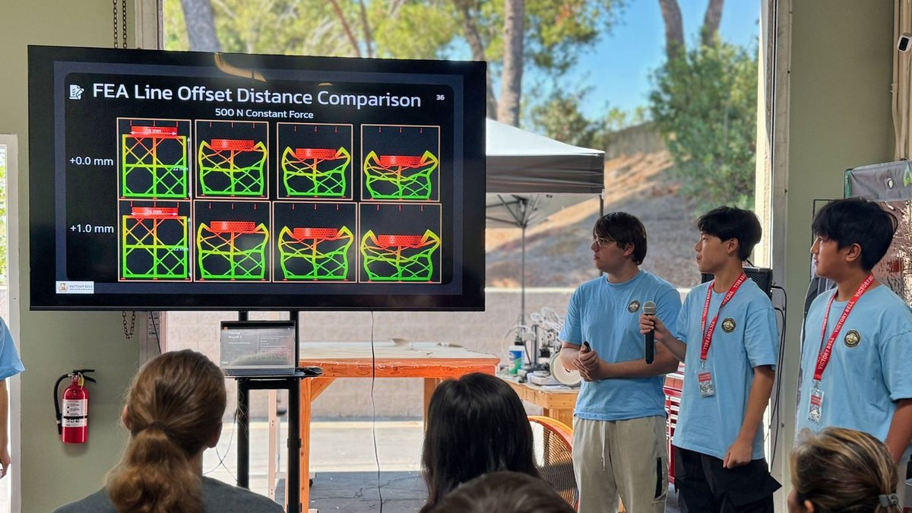</a>
      <h3>Teaching Armor to Feel Its Own Damage</h3>
      VBR RESEARCH CAMP 2026 &nbsp;&middot;&nbsp; SDSU YANG LAB
      
<strong>Excellence in Engineering Design Award</strong>

      
3D-printed lattices modeled on the deep-sea glass sponge and the mantis shrimp, in conductive carbon-black PLA and TPU. When the armor cracks, its electrical resistance changes, so the armor itself reports the damage.

      
<a href="https://duckieoverload.github.io/vbr/">Website</a> &nbsp;&middot;&nbsp; <a href="https://duckieoverload.github.io/vbr/presentation/">Slides</a> &nbsp;&middot;&nbsp; <a href="https://duckieoverload.github.io/vbr/Bio-Inspired_Armor_Slides.pptx">PowerPoint</a> &nbsp;&middot;&nbsp; <a href="https://github.com/DuckieOverload/vbr">Repo</a>

    </td>
    <td width="50%" valign="top">
      <a href="https://duckieoverload.github.io/map/">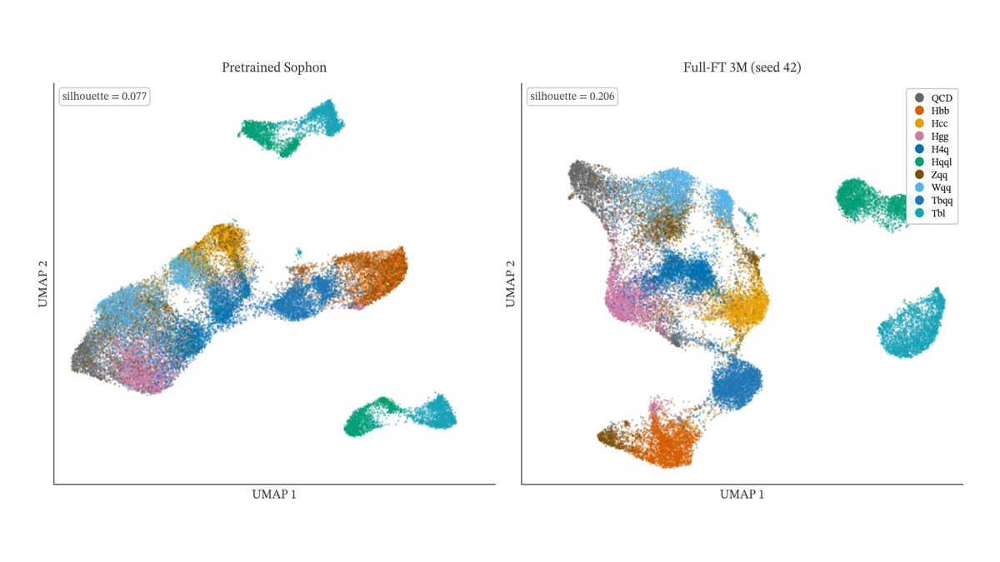</a>
      <h3>Teaching an AI to Identify Particle Collisions</h3>
      UC SAN DIEGO MAP &nbsp;&middot;&nbsp; SAN DIEGO SUPERCOMPUTER CENTER
      
<strong>With Raunav Mendiratta, under Dr. Javier Duarte</strong>

      
Instead of training a jet tagger from scratch, we adapted Sophon, a foundation model pretrained on 188 jet types, to a 10-class task. It reached 99.1% of state-of-the-art accuracy with 1/60th of the trainable parameters.

      
<a href="https://duckieoverload.github.io/map/">Website</a> &nbsp;&middot;&nbsp; <a href="https://duckieoverload.github.io/map/presentation/">Slides</a> &nbsp;&middot;&nbsp; <a href="https://duckieoverload.github.io/map/Sophon_TL.pdf">Poster</a> &nbsp;&middot;&nbsp; <a href="https://github.com/DuckieOverload/transferlearningsophon">Code</a>

    </td>
  </tr>
</table>

## Film

<table>
  <tr>
    <td width="50%" valign="top"><a href="https://duckieoverload.github.io/assisteens/">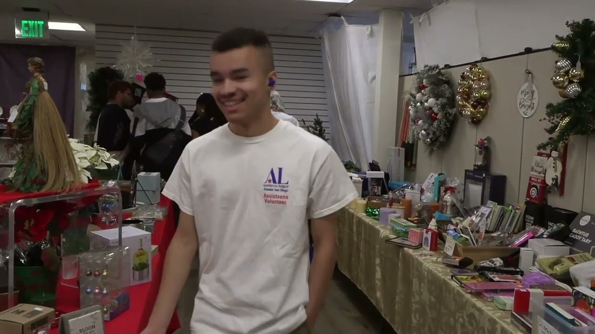</a></td>
    <td width="50%" valign="top">
      <h3>Assisteens: Turning Teenagers into Citizens</h3>
      DOCUMENTARY + RECRUITMENT SHORT &nbsp;&middot;&nbsp; ASSISTANCE LEAGUE OF GREATER SAN DIEGO
      
A short documentary and a 30-second recruitment short about Assisteens, the teen-led volunteer group that helps provide school clothing, books and essentials to kids and families in San Diego.

      
I edited both in DaVinci Resolve, with Lua scripts that build each timeline, grade every shot and lay in the graphics and music.

      
<a href="https://duckieoverload.github.io/assisteens/">Website</a> &nbsp;&middot;&nbsp; <a href="https://www.youtube.com/watch?v=oDFZpPf4yF0">Documentary</a> &nbsp;&middot;&nbsp; <a href="https://www.youtube.com/shorts/ZUe_yq9ZN1c">Short</a> &nbsp;&middot;&nbsp; <a href="https://github.com/DuckieOverload/assisteens">Repo</a>

    </td>
  </tr>
</table>

## Why I love 3D printing

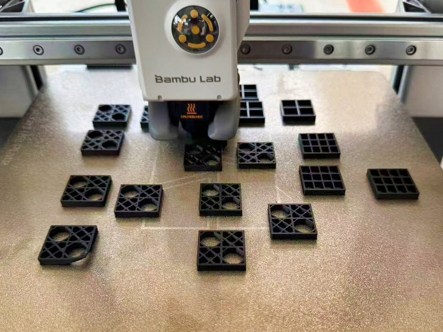

3D printing is how I think through a design. I can model a part in Onshape in the morning and be holding it that afternoon, and if it fails a test, I change one dimension and print it again. On the armor project we printed lattice after lattice on Bambu Lab A1 and H2C printers, and every round of testing kept the best design and changed a single variable.

What I've learned so far:

- **Design with variables.** Driving strut thickness and cell spacing from global variables meant one edit updated every model.
- **Respect the nozzle.** A 0.75 mm lattice line was too fine for a 0.4 mm nozzle, so only the outer frame printed.
- **Flexible filament fights back.** TPU printed best kept dry and hand-fed without the PTFE tube, with the idler screws backed off 1.5 turns.
- **The part can be the sensor.** Conductive filament changes resistance as it cracks.
- **No two prints are identical.** Ten copies of one design gave ten slightly different results, so test more than once.

Next I want to try PETG and ABS.

 

## Tools

&nbsp;

&nbsp;

&nbsp;

&nbsp;

## Minecraft mods and packs

I also make Minecraft mods, datapacks and resource packs. They're all on [Modrinth](https://modrinth.com/user/duckieoverload1), where they've been downloaded more than 1,300 times.

<table>
  <tr>
    <td width="50%" valign="top"><a href="https://modrinth.com/project/adapted-origins-legacy">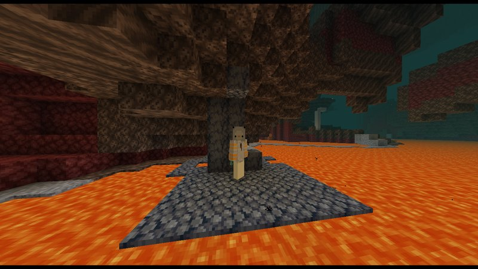</a></td>
    <td width="50%" valign="top">
      <h3> Adapted Origins Legacy</h3>
      DATAPACK &nbsp;&middot;&nbsp; MINECRAFT 1.21.5&ndash;1.21.11 &nbsp;&middot;&nbsp; ORIGINS LEGACY
      
A modern update to IHasName's "Adapted/Evolving Origins" datapack. Designed for Origins Legacy.

      
Defeat the Ender Dragon and your origin evolves into an adapted version with new powers. Adds three new origins too: the Nevian, the Undying and the Ashen Skeleton.

      
<a href="https://modrinth.com/project/adapted-origins-legacy">Modrinth</a> &nbsp;&middot;&nbsp; <a href="https://github.com/DuckieOverload/Adapted-Origins-Legacy">Repo</a> &nbsp;&middot;&nbsp; <a href="https://github.com/DuckieOverload/Adapted-Origins-Legacy/wiki">Wiki</a> &nbsp; 

    </td>
  </tr>
  <tr>
    <td width="50%" valign="top">
      <a href="https://modrinth.com/project/duckies-peaceful-plus">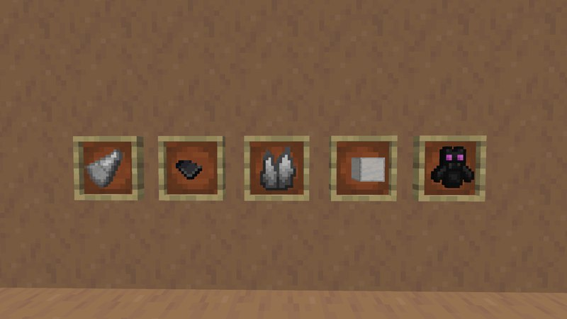</a>
      <h3> Duckie's Peaceful +</h3>
      MOD &nbsp;&middot;&nbsp; NEOFORGE &nbsp;&middot;&nbsp; MINECRAFT 1.21.4
      
A mod that aims to add new ways to get features that are not possible to get in regular peaceful mode

      
Adds trident shards, soul shards, a Prismarine Shrine structure and a Dragon Totem for beating the Ender Dragon, plus new recipes and trades. Made with MCreator and Blockbench.

      
<a href="https://modrinth.com/project/duckies-peaceful-plus">Modrinth</a> &nbsp; 

    </td>
    <td width="50%" valign="top">
      <a href="https://modrinth.com/project/duckies-prime-sisyphus-warden">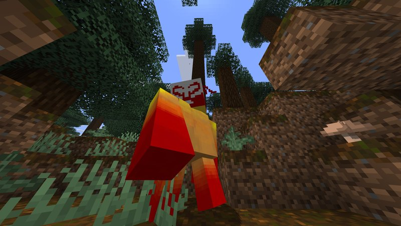</a>
      <h3>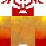 Duckie's Prime Sisyphus Warden</h3>
      RESOURCE PACK &nbsp;&middot;&nbsp; MINECRAFT 1.21&ndash;1.21.10
      
Transforms the Warden into Prime Sisyphus from Ultrakill. Complete with SFX.

      
Textures by me, sounds from Ultrakill.

      
<a href="https://modrinth.com/project/duckies-prime-sisyphus-warden">Modrinth</a> &nbsp; 

    </td>
  </tr>
  <tr>
    <td width="50%" valign="top">
      <a href="https://modrinth.com/project/duckies-minos-prime-creaking">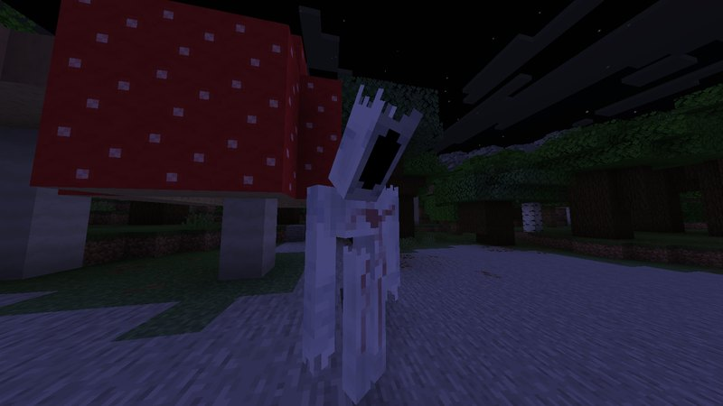</a>
      <h3> Duckie's Minos Prime Creaking</h3>
      RESOURCE PACK &nbsp;&middot;&nbsp; MINECRAFT 1.21.5&ndash;1.21.10
      
Transforms the Creaking into Minos Prime from Ultrakill. Complete with a textured spawn egg and SFX.

      
Textures by me, sounds from Ultrakill.

      
<a href="https://modrinth.com/project/duckies-minos-prime-creaking">Modrinth</a> &nbsp; 

    </td>
    <td width="50%" valign="top">
      <a href="https://modrinth.com/project/minecraft-rw-citzen-id-drone-totem">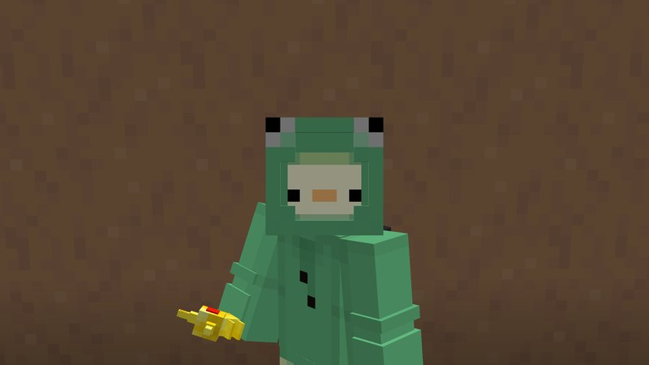</a>
      <h3>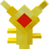 Minecraft RW Citizen-ID Drone totem</h3>
      RESOURCE PACK &nbsp;&middot;&nbsp; MINECRAFT 1.21&ndash;1.21.10
      
A Resource pack that turns the totem of undying into the Citizen-ID Drone from Rain World.

      
<a href="https://modrinth.com/project/minecraft-rw-citzen-id-drone-totem">Modrinth</a> &nbsp; 

    </td>
  </tr>
</table>
